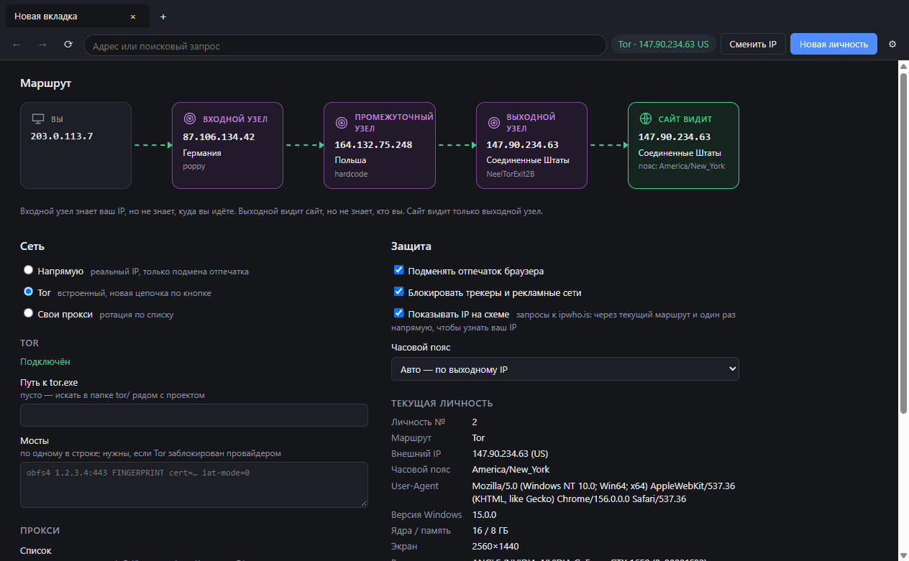

# Brauser

Приватный браузер на Electron (движок Chromium): подмена отпечатка, встроенный Tor и ротация прокси.



## Установка

**Linux Mint / Ubuntu / Debian** — одна команда в терминале:

```bash
wget -qO- https://raw.githubusercontent.com/zxaty/brauser/main/install.sh | sh
```

Потом запуск командой `brauser` или из меню приложений. Удаление: `sudo apt remove brauser`.

**Windows** — скачайте установщик со страницы [Releases](https://github.com/zxaty/brauser/releases/latest) и запустите. SmartScreen предупредит о неподписанном файле: «Подробнее» → «Выполнить в любом случае».

Tor уже внутри обеих сборок. Чтобы включить: шестерёнка → режим «Tor» → «Применить».

## Запуск из исходников

```bash
npm install
```

```bash
npm start
```

Самопроверка подмены отпечатка (без окна, результат в консоли):

```bash
npm run selftest
```

То же плюс подключение к Tor и двойная смена цепочки (до пары минут):

```bash
npm run selftest:tor
```

## Сборка установщика

```bash
npm run dist
```

Результат — `dist/Brauser-Setup-0.2.0.exe` (установщик, Tor внутри) и `dist/win-unpacked/Brauser.exe` (версия без установки). Установщик не подписан, поэтому Windows SmartScreen покажет предупреждение — «Подробнее» → «Выполнить в любом случае».

### Linux (Mint, Ubuntu, Debian)

С Windows, через Docker Desktop (должен быть запущен):

```bash
npm run dist:linux:docker
```

На самом Linux, из корня проекта:

```bash
npm run dist:linux
```

Результат — `dist/brauser_0.2.0_amd64.deb`, Tor для Linux внутри (берётся из `vendor/`). Установка на Mint:

```bash
sudo apt install ./brauser_0.2.0_amd64.deb
```

После установки браузер появится в меню приложений, из терминала запускается командой `brauser`.

## Что умеет

- **Личности.** Каждая личность — отдельная сессия в памяти (куки и кэш на диск не пишутся) со своим отпечатком. Кнопка «Новая личность» закрывает вкладки, стирает данные, меняет IP и отпечаток.
- **Схема маршрута.** Клик по индикатору в адресной строке показывает путь трафика: вы → узлы Tor или прокси → IP, который видит сайт. Для Tor это реальные узлы текущей цепочки с IP и странами.
- **Смена IP.** Три режима: напрямую, встроенный Tor (новая цепочка по кнопке), свой список прокси (SOCKS5/SOCKS4/HTTP/HTTPS, ротация вручную или по таймеру). Кнопка «Сменить IP» меняет маршрут, не закрывая вкладки.
- **Подмена отпечатка.** User-Agent и Client Hints как у обычного Chrome под Windows, число ядер, память, размер экрана, модель видеокарты в WebGL, шум в canvas и аудио, часовой пояс по выходному IP, язык en-US.
- **Защита от утечек.** WebRTC не ходит мимо прокси, DNS уходит через прокси (напрямую — через DoH, если доступен), при упавшем Tor/прокси трафик не идёт напрямую, все разрешения сайтам (гео, камера, уведомления) запрещены.
- **Блокировка трекеров** по встроенному списку доменов (`src/blocklist.js`).

## Tor

В папке `tor/` лежит официальный **Tor Expert Bundle** 16.0.1 для Windows (скачан с dist.torproject.org, SHA-256 сверен). Для обновления распакуйте новую версию туда же, чтобы получилось `tor/tor/tor.exe`. Либо укажите путь к `tor.exe` в настройках.

Бинарники Tor в git не хранятся. После клонирования скачайте их с https://dist.torproject.org/torbrowser/16.0.1/ и сверьте SHA-256:

| Файл | Куда | SHA-256 |
|---|---|---|
| `tor-expert-bundle-windows-x86_64-16.0.1.tar.gz` | распаковать в `tor/` | `9eed3c3ff1fe43df034ce360196c9ec95472560d77ff55614d0cd5120edea27b` |
| `tor-expert-bundle-linux-x86_64-16.0.1.tar.gz` | положить архивом в `vendor/` | `7039cb16060ab22e669852e55774d894b55f25ea8bd0ab7194d3478429a58725` |

Если Tor заблокирован провайдером, впишите мосты (obfs4/webtunnel) в настройках — их выдаёт bridges.torproject.org.

## Ограничения

- Это не Tor Browser: у него миллионы пользователей с одинаковым отпечатком, а здесь отпечаток случайный, но «свой». От продвинутого фингерпринтинга (шрифты, тайминги, особенности TLS) защита неполная.
- Подмена canvas/WebGL/аудио сделана скриптом: она действует в страницах, фреймах и обычных web-воркерах, но не в service-воркерах. User-Agent, ядра и часовой пояс подменяются на уровне движка.
- Chromium не поддерживает логин/пароль для SOCKS5 — прокси с авторизацией работают только по HTTP/HTTPS.
- Пароли прокси хранятся открытым текстом в `settings.json` в папке данных приложения.
- В прямом режиме скрывается только отпечаток, IP остаётся настоящим.

## Структура

| Файл | Назначение |
|---|---|
| `src/main.js` | окно, вкладки, личности, прокси, IPC |
| `src/persona.js` | генерация параметров отпечатка |
| `src/inject.js` | скрипт подмены, внедряемый в страницы |
| `src/tor.js` | запуск Tor и команда NEWNYM |
| `src/proxy.js` | разбор списка прокси |
| `src/blocklist.js` | домены трекеров |
| `src/ui/` | интерфейс: панель вкладок, адресная строка, настройки |
