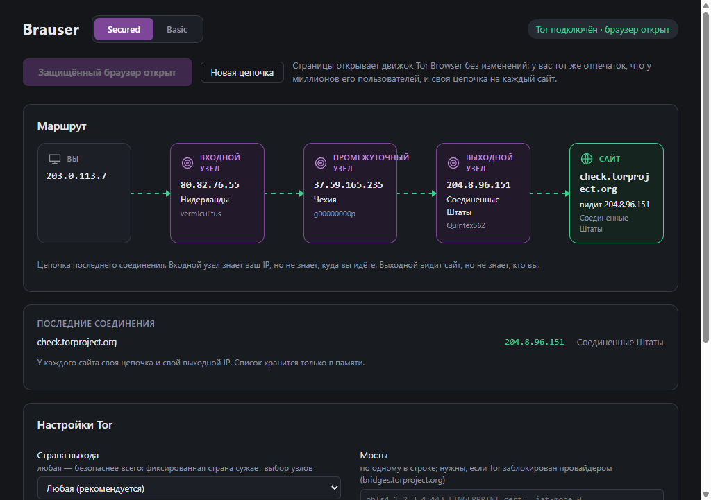
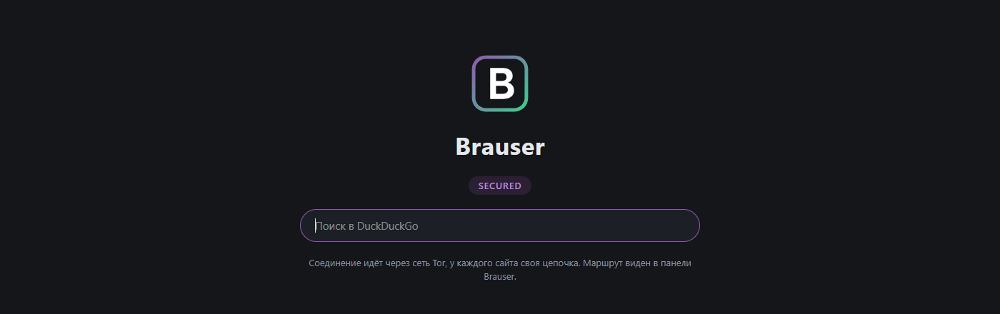

# Brauser

Браузер с двумя режимами:

- **Secured** — страницы открывает движок Tor Browser, подключённый к сети Tor. От Brauser у него только оформление: название, логотип и стартовая страница. Brauser запускает Tor, управляет им и показывает схему маршрута с реальными узлами цепочки.
- **Basic** — обычный быстрый браузер с вкладками, без Tor и задержек. Блокирует трекеры, но сайты видят ваш настоящий IP.





## Установка

**Linux Mint / Ubuntu / Debian** — одна команда в терминале:

```bash
wget -qO- https://raw.githubusercontent.com/zxaty/brauser/main/install.sh | sh
```

Потом запуск командой `brauser` или из меню приложений. Удаление: `sudo apt remove brauser`.

**Windows** — скачайте установщик со страницы [Releases](https://github.com/zxaty/brauser/releases/latest) и запустите. SmartScreen предупредит о неподписанном файле: «Подробнее» → «Выполнить в любом случае».

При первом запуске в режиме Secured Brauser распаковывает движок Tor Browser в папку данных пользователя — это занимает до минуты.

## Режим Secured

- **Защита — от Tor Browser.** Тот же отпечаток, что у всех пользователей Tor Browser, своя цепочка на каждый сайт, его же правила изоляции. Brauser не добавляет в движок расширений и не меняет ничего, что видит сайт.
- **Оформление — своё.** Название и логотипы в интерфейсе движка заменены на Brauser, стартовая страница своя (локальный файл). Правится только архив ресурсов интерфейса (`browser/omni.ja`) и домашняя страница в профиле; после автообновления движка правки накладываются заново при запуске (`src/rebrand.js`).
- **Tor запускает панель.** Движок подключается к этому же процессу Tor, поэтому панель видит каждое соединение и может им управлять.
- **Схема маршрута.** Вы → входной → промежуточный → выходной узел → сайт: реальные узлы цепочки последнего соединения, с IP и странами. Ниже — список последних сайтов и их выходных IP (хранится только в памяти).
- **Новая цепочка** — одной кнопкой: следующие соединения пойдут с других IP.
- **Страна выхода**, **мосты** (если Tor блокирует провайдер) и **прокси перед Tor** (провайдер видит соединение с прокси, а не с Tor).
- **Поиск в цветах Brauser.** Поиск остаётся DuckDuckGo, но открывается в тёмной теме с цветами Brauser и без рекламы. Это штатные параметры оформления самого DuckDuckGo (`src/search.js`), страница со стороны браузера не изменяется. Сами параметры поисковик, разумеется, видит.
- **`brauser --open=https://…`** сразу открывает адрес в защищённом браузере.
- **Обновления движка.** Tor Browser установлен в папку пользователя и обновляется сам, штатным механизмом.

Что стоит знать:

- Панель закрывается вместе с защищённым браузером: без её Tor он в сеть не выйдет (и напрямую тоже не пойдёт).
- Опция «Показывать мой IP на схеме» делает один прямой запрос к ipwho.is мимо Tor. Её можно выключить.
- Фиксированная страна выхода удобна, но сужает выбор узлов и немного снижает анонимность.
- Провайдер по-прежнему видит, что вы подключаетесь к Tor, — оформление на это не влияет. Скрыть это помогают мосты или прокси перед Tor.
- На Windows процесс движка в диспетчере задач называется `firefox.exe`, и значок на панели задач берётся из него.

## Режим Basic

Обычный браузер на встроенном Chromium: вкладки, адресная строка с поиском в DuckDuckGo, вход на сайты сохраняется между запусками. Соединение прямое. Из защиты — блокировка трекеров по списку (`src/blocklist.js`) и запрет сайтам на камеру, геолокацию и уведомления. Анонимности в этом режиме нет.

В режиме Basic Tor не запускается вообще.

## Запуск из исходников

Положите в `vendor/` архив Tor Browser для своей системы с https://dist.torproject.org/torbrowser/16.0.1/ и сверьте SHA-256:

| Файл | SHA-256 |
|---|---|
| `tor-browser-linux-x86_64-16.0.1.tar.xz` | `5b36ad610c20c81faa72caf27d1cd3a11f14a327c320b4cec581400016ba78b0` |
| `tor-browser-windows-x86_64-portable-16.0.1.exe` | `fbef840ba111409213dec2291e3594a43b82525545cdef0490a5750f24f5f232` |

```bash
npm install
```

```bash
npm start
```

Самопроверка обоих режимов (откроет окно Tor Browser, результат в консоли):

```bash
npm run selftest
```

## Сборка

Windows-установщик (`dist/Brauser-Setup-1.1.0.exe`):

```bash
npm run dist
```

Пакет для Linux (`dist/brauser_1.1.0_amd64.deb`) — на самом Linux:

```bash
npm run dist:linux
```

Или с Windows через запущенный Docker Desktop:

```bash
npm run dist:linux:docker
```

## Структура

| Файл | Назначение |
|---|---|
| `src/main.js` | панель управления: окно, настройки, режимы, данные для схемы |
| `src/tor.js` | запуск Tor, control-порт, цепочки, события соединений |
| `src/browser.js` | установка и запуск движка Tor Browser |
| `src/rebrand.js` | оформление движка под Brauser |
| `assets/brand/` | логотип и иконки (`scripts/make-icons.js` пересоздаёт PNG из SVG) |
| `src/basic.js` | режим Basic: окно с вкладками |
| `src/proxy.js` | разбор адреса прокси |
| `src/blocklist.js` | домены трекеров для режима Basic |
| `src/ui/` | интерфейс панели и окна Basic |

Tor Browser — продукт The Tor Project. Brauser с ним не связан: он использует официальную сборку движка и меняет в ней только оформление.
